# OpenGameArt: textures

**51 assets from [OpenGameArt](https://opengameart.org), dedicated to the public domain under [CC0](https://creativecommons.org/publicdomain/zero/1.0/).** Use them in any game, free or paid, and change them however you like; no credit is needed.

Textures from OpenGameArt entries licensed CC0 (some also offer other licences; CC0 is the one that applies here). 915.5 MB in all.

This is a copy kept by [zuujis-cc0](https://github.com/zuujis-cc0) so game makers can take single files from GitHub. It is not made by or affiliated with OpenGameArt: the originals, often in more formats and higher resolutions, are on [opengameart.org](https://opengameart.org). If they help you, consider [supporting OpenGameArt](https://opengameart.org/content/faq).

Every file is listed in [MANIFEST.tsv](MANIFEST.tsv) with its size and SHA-256. More free assets: [the Zuujis collection](https://github.com/zuujis-cc0/free-game-assets#readme).

| | | | |
| :-: | :-: | :-: | :-: |
| <a href="animal-patterns">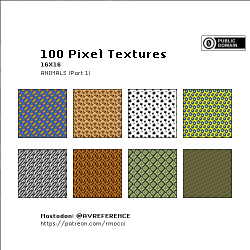</a> <b><a href="animal-patterns">Animal patterns</a></b> by AV Reference · <a href="https://opengameart.org/content/animal-patterns">source</a> | <a href="another-photo-texture-pack">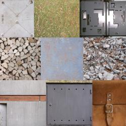</a> <b><a href="another-photo-texture-pack">Another Photo Texture Pack</a></b> by Drummyfish · <a href="https://opengameart.org/content/another-photo-texture-pack">source</a> | <a href="awesome-seamless-grass-texture">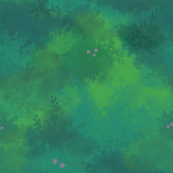</a> <b><a href="awesome-seamless-grass-texture">Awesome Seamless Grass Texture :)</a></b> by Flashy Feather Games · <a href="https://opengameart.org/content/awesome-seamless-grass-texture">source</a> | <a href="base-material-texture-pack">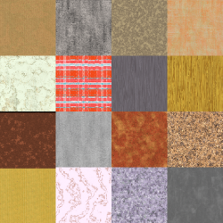</a> <b><a href="base-material-texture-pack">Base Material Texture Pack</a></b> by Screaming Brain Studios · <a href="https://opengameart.org/content/base-material-texture-pack">source</a> |
| <a href="blue-pool-tiles">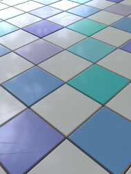</a> <b><a href="blue-pool-tiles">Blue Pool Tiles</a></b> by genderfreak · <a href="https://opengameart.org/content/blue-pool-tiles">source</a> | <a href="box-and-barrel-textures">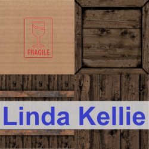</a> <b><a href="box-and-barrel-textures">Box and barrel textures</a></b> by Starry Skydancer · <a href="https://opengameart.org/content/box-and-barrel-textures">source</a> | <a href="bricks-and-tiles">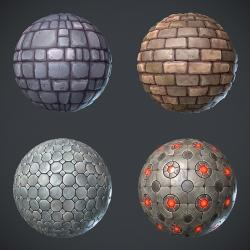</a> <b><a href="bricks-and-tiles">Bricks and tiles</a></b> by Kutejnikov · <a href="https://opengameart.org/content/bricks-and-tiles">source</a> | <a href="brushed-rocks">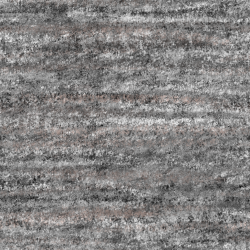</a> <b><a href="brushed-rocks">Brushed rocks</a></b> by Starry Skydancer · <a href="https://opengameart.org/content/brushed-rocks">source</a> |
|  <b><a href="chalkboard-texture">Chalkboard Texture</a></b> by MonoTone · <a href="https://opengameart.org/content/chalkboard-texture">source</a> | <a href="clear-sky-panoramic-texture">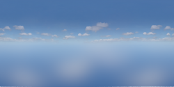</a> <b><a href="clear-sky-panoramic-texture">Clear sky panoramic texture</a></b> by _Creature_ · <a href="https://opengameart.org/content/clear-sky-panoramic-texture">source</a> |  <b><a href="cloudy-sky-panoramic-texture">Cloudy sky panoramic texture</a></b> by _Creature_ · <a href="https://opengameart.org/content/cloudy-sky-panoramic-texture">source</a> | <a href="crates-2">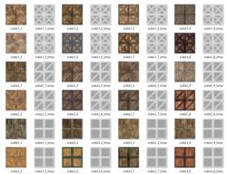</a> <b><a href="crates-2">Crates</a></b> by Shadowman · <a href="https://opengameart.org/content/crates-2">source</a> |
| <a href="dmgrmygrnswtchywll1-doomish-material">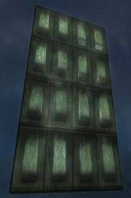</a> <b><a href="dmgrmygrnswtchywll1-doomish-material">dmgrmygrnswtchywll1 (DOOMish material)</a></b> by LDAsh · <a href="https://opengameart.org/content/dmgrmygrnswtchywll1-doomish-material">source</a> | <a href="earths-moon-photomanip">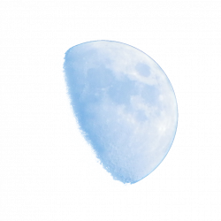</a> <b><a href="earths-moon-photomanip">Earth's moon photomanip</a></b> by Starry Skydancer · <a href="https://opengameart.org/content/earths-moon-photomanip">source</a> | <a href="eye-texture">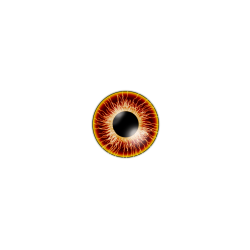</a> <b><a href="eye-texture">Eye texture</a></b> by byzmod3d · <a href="https://opengameart.org/content/eye-texture">source</a> | <a href="floor-tile-texture">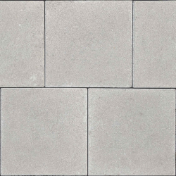</a> <b><a href="floor-tile-texture">Floor Tile Texture</a></b> by Ravaen · <a href="https://opengameart.org/content/floor-tile-texture">source</a> |
| <a href="floor-tiles-pbr">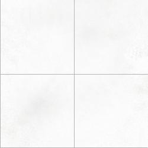</a> <b><a href="floor-tiles-pbr">Floor Tiles PBR</a></b> by trinitrotoluene · <a href="https://opengameart.org/content/floor-tiles-pbr">source</a> | <a href="grass-9">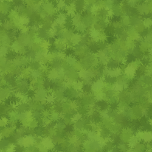</a> <b><a href="grass-9">Grass</a></b> by Starry Skydancer · <a href="https://opengameart.org/content/grass-9">source</a> | <a href="gritty-lowres-scifi-wall-and-floor-textures">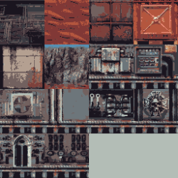</a> <b><a href="gritty-lowres-scifi-wall-and-floor-textures">Gritty Lowres Scifi Wall and Floor Textures</a></b> by CptDrunkBear · <a href="https://opengameart.org/content/gritty-lowres-scifi-wall-and-floor-textures">source</a> | <a href="groundcover">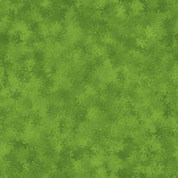</a> <b><a href="groundcover">Groundcover</a></b> by Starry Skydancer · <a href="https://opengameart.org/content/groundcover">source</a> |
|  <b><a href="hand-drawn-ivy-leaf">Hand-Drawn Ivy Leaf</a></b> by Mittzy · <a href="https://opengameart.org/content/hand-drawn-ivy-leaf">source</a> | <a href="holiday-texture-pack">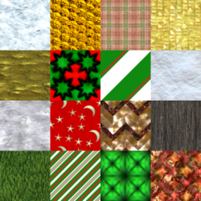</a> <b><a href="holiday-texture-pack">Holiday Texture Pack</a></b> by Screaming Brain Studios · <a href="https://opengameart.org/content/holiday-texture-pack">source</a> | <a href="horror-texture-pack">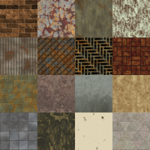</a> <b><a href="horror-texture-pack">Horror Texture Pack</a></b> by Screaming Brain Studios · <a href="https://opengameart.org/content/horror-texture-pack">source</a> | <a href="hotspot-texture-templates">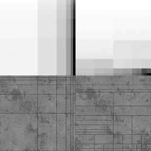</a> <b><a href="hotspot-texture-templates">Hotspot texture templates</a></b> by Chloe Burden · <a href="https://opengameart.org/content/hotspot-texture-templates">source</a> |
| <a href="imperfect-tile-rpifogismrmlmlnlmflr1-material">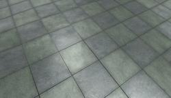</a> <b><a href="imperfect-tile-rpifogismrmlmlnlmflr1-material">Imperfect Tile (rpifogismrmlmlnlmflr1) material</a></b> by LDAsh · <a href="https://opengameart.org/content/imperfect-tile-rpifogismrmlmlnlmflr1-material">source</a> | <a href="liquid-splatter-pixel-texture"></a> <b><a href="liquid-splatter-pixel-texture">Liquid Splatter Pixel Texture</a></b> by AlejandroHaibi · <a href="https://opengameart.org/content/liquid-splatter-pixel-texture">source</a> | <a href="n64-eyes">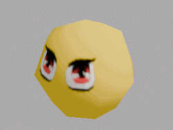</a> <b><a href="n64-eyes">N64 Eyes</a></b> by n64guy · <a href="https://opengameart.org/content/n64-eyes">source</a> | <a href="n64-texture-pack">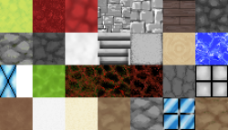</a> <b><a href="n64-texture-pack">N64 Texture Pack</a></b> by n64guy · <a href="https://opengameart.org/content/n64-texture-pack">source</a> |
| <a href="old-cardmancer-hand-painted-tiles">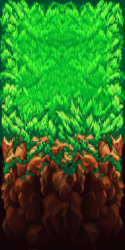</a> <b><a href="old-cardmancer-hand-painted-tiles">Old CardMancer Hand Painted Tiles</a></b> by Chloe Wolfe · <a href="https://opengameart.org/content/old-cardmancer-hand-painted-tiles">source</a> | <a href="old-jute">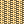</a> <b><a href="old-jute">Old jute</a></b> by ShggothSlave · <a href="https://opengameart.org/content/old-jute">source</a> |  <b><a href="particle-textures">Particle textures</a></b> by Starry Skydancer · <a href="https://opengameart.org/content/particle-textures">source</a> | <a href="photomanipulated-plant-textures">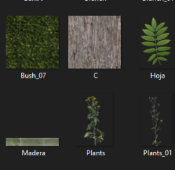</a> <b><a href="photomanipulated-plant-textures">Photomanipulated plant textures</a></b> by Starry Skydancer · <a href="https://opengameart.org/content/photomanipulated-plant-textures">source</a> |
| <a href="photorealistic-texture-pack-3">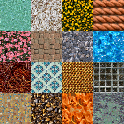</a> <b><a href="photorealistic-texture-pack-3">Photorealistic Texture Pack 3</a></b> by Screaming Brain Studios · <a href="https://opengameart.org/content/photorealistic-texture-pack-3">source</a> | <a href="pipes-texture-2k">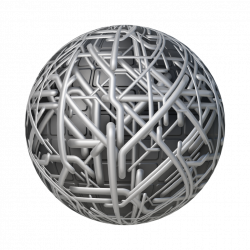</a> <b><a href="pipes-texture-2k">Pipes texture 2K</a></b> by YCbCr · <a href="https://opengameart.org/content/pipes-texture-2k">source</a> | <a href="pixel-patterns-2">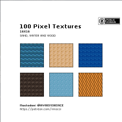</a> <b><a href="pixel-patterns-2">Pixel Patterns 2</a></b> by AV Reference · <a href="https://opengameart.org/content/pixel-patterns-2">source</a> | <a href="plastic-gravel-container">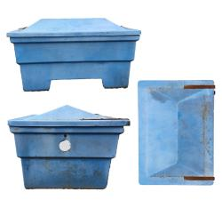</a> <b><a href="plastic-gravel-container">Plastic Gravel Container</a></b> by EyAxeMan · <a href="https://opengameart.org/content/plastic-gravel-container">source</a> |
| <a href="procedural-rocks">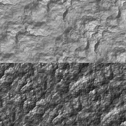</a> <b><a href="procedural-rocks">Procedural rocks</a></b> by Starry Skydancer · <a href="https://opengameart.org/content/procedural-rocks">source</a> | <a href="quaternius-tree-textures-curated">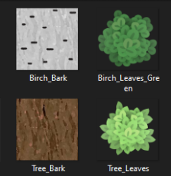</a> <b><a href="quaternius-tree-textures-curated">Quaternius tree textures curated</a></b> by Starry Skydancer · <a href="https://opengameart.org/content/quaternius-tree-textures-curated">source</a> |  <b><a href="quaternius-tree-textures-curated-0">Quaternius tree textures curated</a></b> by Starry Skydancer · <a href="https://opengameart.org/content/quaternius-tree-textures-curated-0">source</a> | <a href="rain-1">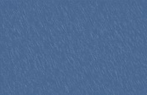</a> <b><a href="rain-1">rain</a></b> by gmason · <a href="https://opengameart.org/content/rain-1">source</a> |
| <a href="seamless-cobblestone-retro-low-resolution">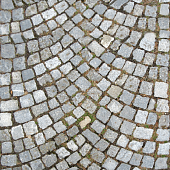</a> <b><a href="seamless-cobblestone-retro-low-resolution">Seamless Cobblestone - Retro low resolution</a></b> by Tegurd · <a href="https://opengameart.org/content/seamless-cobblestone-retro-low-resolution">source</a> |  <b><a href="simple-stylized-toon-seamless-rock-or-stone-texture">Simple Stylized Toon Seamless Rock or Stone Texture</a></b> by Feraly · <a href="https://opengameart.org/content/simple-stylized-toon-seamless-rock-or-stone-texture">source</a> | <a href="soft-carpet-sand">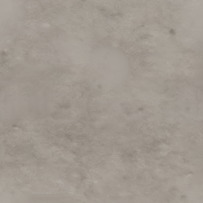</a> <b><a href="soft-carpet-sand">soft carpet sand</a></b> by opengameartdotorg user · <a href="https://opengameart.org/content/soft-carpet-sand">source</a> |  <b><a href="suns-and-moons-pack">Suns and moons pack</a></b> by Starry Skydancer · <a href="https://opengameart.org/content/suns-and-moons-pack">source</a> |
| <a href="water-pack-1">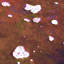</a> <b><a href="water-pack-1">Water Pack 1</a></b> by TheDikTatorTot · <a href="https://opengameart.org/content/water-pack-1">source</a> | <a href="wood-texture-2">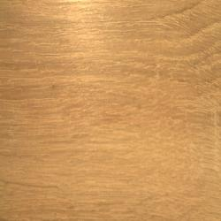</a> <b><a href="wood-texture-2">Wood Texture</a></b> by nuclearweb · <a href="https://opengameart.org/content/wood-texture-2">source</a> | <a href="wooden-floors-2k">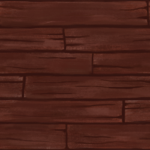</a> <b><a href="wooden-floors-2k">Wooden Floors (2K)</a></b> by PamNawi · <a href="https://opengameart.org/content/wooden-floors-2k">source</a> | <a href="y2k-texture-pack">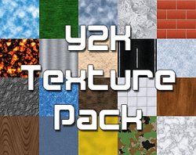</a> <b><a href="y2k-texture-pack">Y2K Texture Pack</a></b> by GGBotNet · <a href="https://opengameart.org/content/y2k-texture-pack">source</a> |
| <a href="yet-another-photo-texture-pack">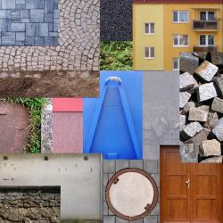</a> <b><a href="yet-another-photo-texture-pack">Yet Another Photo Texture Pack</a></b> by Drummyfish · <a href="https://opengameart.org/content/yet-another-photo-texture-pack">source</a> | <a href="zortch-2-more-rejected-textures-pack-2">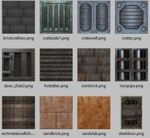</a> <b><a href="zortch-2-more-rejected-textures-pack-2">Zortch 2 more rejected textures (pack 2)</a></b> by mutantleg · <a href="https://opengameart.org/content/zortch-2-more-rejected-textures-pack-2">source</a> | <a href="zortch-2-rejected-textures">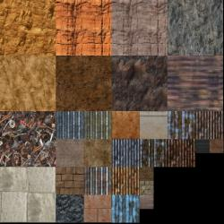</a> <b><a href="zortch-2-rejected-textures">Zortch 2 Rejected Textures</a></b> by mutantleg · <a href="https://opengameart.org/content/zortch-2-rejected-textures">source</a> |  |

---

Kept up to date by this repository's own [update workflow](.github/workflows/update.yml), with code and plan from [cc0-mirror](https://github.com/zuujis-cc0/cc0-mirror). Something wrong? [Open an issue there](https://github.com/zuujis-cc0/cc0-mirror/issues/new) or use the [private report form](https://games.zuujis.com/report).
